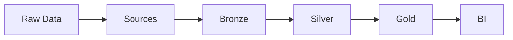
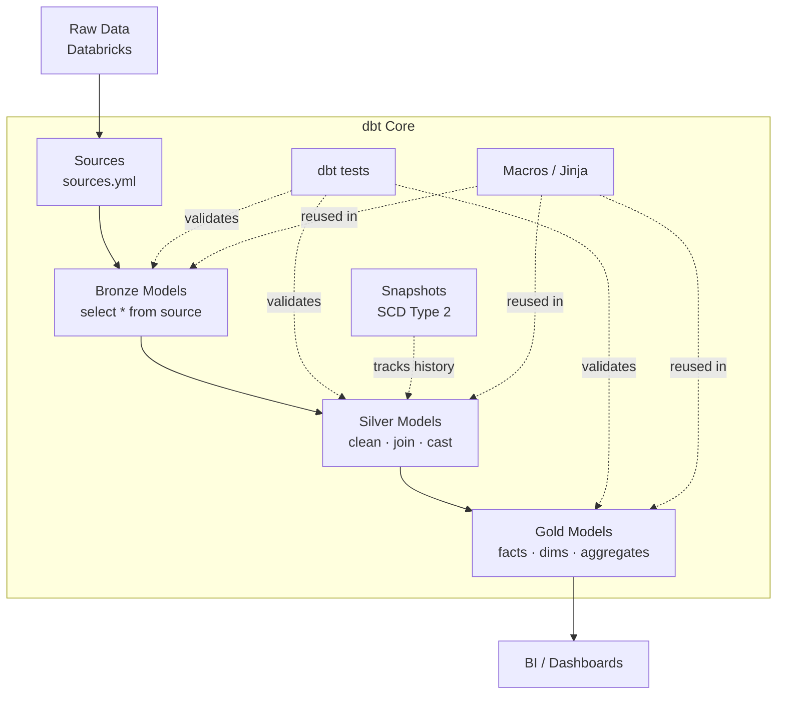

# GitHub README 
```markdown
# dbt on Databricks — Bronze/Silver/Gold Pipeline

A dbt Core project running on Databricks, implementing a medallion architecture with tests, snapshots, and multi-environment support.

## Stack
- dbt Core 1.12 + dbt-databricks
- Databricks SQL Warehouse + Unity Catalog
- UV for dependency management
- Git for version control

## Architecture



## Project Structure
```
models/
├── bronze/    # passthrough from sources
├── silver/    # cleaned, joined
└── gold/      # facts, dims, aggregates
snapshots/     # SCD Type 2
tests/         # singular tests
macros/        # reusable Jinja
```

## Setup

```bash
uv sync
.venv/Scripts/activate
dbt debug
```

Configure `~/.dbt/profiles.yml` with Databricks host, http_path, catalog, and token (scope: `sql`).

## Commands

| Command | Purpose |
|---|---|
| `dbt parse` | Validate config |
| `dbt run` | Build models |
| `dbt test` | Run tests |
| `dbt build` | run + test + snapshot + seed |
| `dbt build --target prod` | Deploy to prod |

## Environment Parametrization

`profiles.yml` uses `env_var()` so the same project runs against dev or prod:

```yaml
dev:
  catalog: "{{ env_var('DBT_CATALOG_DEV', 'dbt_practice_dev') }}"
prod:
  catalog: "{{ env_var('DBT_CATALOG_PROD', 'dbt_practice_prod') }}"
```
---
---
# dbt on Databricks :#WhatILearned #Notes

> Personal reference built from the course + hands-on debugging. Covers setup, concepts, errors hit, and how to run the project.

---

## 1. What dbt Is (and Isn't)

**dbt (data build tool) handles the "T" (Transform) layer in ELT pipelines.** It does not move data — it compiles SQL/Jinja models and executes them inside Databricks (or Snowflake, etc.) to produce clean, analytics-ready datasets.

- **What it gives you:** modularity via `ref()`, Jinja templating, built-in tests, docs/lineage, Git-versioned models, pushdown execution.
- **What it doesn't do:** extract/load data, orchestrate schedules (that's Airflow/Databricks Jobs), replace PySpark for complex processing.
- **PySpark still fits:** dbt supports **Python models** on Databricks, but only `table` and `incremental` materializations.

### Why dbt over plain PySpark notebooks
PySpark can transform, but doesn't give you dependency management, automated tests, or lineage out of the box. dbt wraps transformation logic in software-engineering discipline: version control, branching, CI, reproducibility.

---

## 2. Platform Forms

| Form | Positioning |
|---|---|
| **dbt Core** | Open-source CLI, free — what this project uses |
| **dbt Cloud** | Managed IDE, scheduling, semantic layer |
| **dbt Canvas** | No-code / drag-and-drop, generates SQL + commits to Git |

**Course choice:** dbt Core on Databricks — write locally, compute in warehouse, version in Git.

---

## 3. Environment Setup (UV)

UV is a Rust-based package manager replacing pip/venv.

```bash
uv init
uv sync                    # installs deps from pyproject.toml
.venv/Scripts/activate     # Windows
# or: source .venv/bin/activate
uv run dbt --version
```

- `pyproject.toml` is the single source of dependencies (better than `requirements.txt`: dependency groups, env markers, native uv lockfile).
- `dbt-databricks` is the adapter dependency.

---

## 4. Connecting dbt to Databricks

**Connection lives in `profiles.yml`**, by default at `C:\Users\<you>\.dbt\profiles.yml`. A copy inside the project takes priority.

```yaml
dbt_project:
  outputs:
    dev:
      catalog: dbt_practice_dev
      host: dbc-xxxx.cloud.databricks.com
      http_path: /sql/1.0/warehouses/xxxx
      schema: default
      threads: 1
      token: "{{ env_var('DBT_TOKEN') }}"
      type: databricks
  target: dev
```

**Token:** generate a PAT in Databricks with the **`sql`** scope (BI/SQL workloads). OAuth is now the recommended method; PAT is legacy but fine for local dev.

**Permissions (Unity Catalog):** `USE CATALOG`, `USE SCHEMA`, `SELECT`, `CREATE TABLE`, `CREATE VIEW`, `MODIFY`.

**Verify:**
```bash
dbt debug
```

---

## 5. Project Structure

```
dbt_project/
├── analyses/        # ad-hoc compiled SQL (NOT executed; target context unreliable)
├── macros/          # reusable Jinja functions
├── models/
│   ├── bronze/      # raw passthrough from sources
│   ├── silver/      # cleaned, joined, conformed
│   └── gold/        # facts, dims, aggregates
├── seeds/           # small CSV lookup tables
├── snapshots/       # SCD Type 2 history
├── tests/           # singular tests
├── dbt_project.yml
└── pyproject.toml
```

`dbt_project.yml` model config:

```yaml
models:
  dbt_project:
    bronze:
      +materialized: table
    silver:
      +materialized: table
      schema: silver
    gold:
      +materialized: table
      schema: gold
```

**Config precedence (lowest → highest):**
`dbt_project.yml` → `schema.yml`/properties file → in-model `{{ config() }}` block.

---

## 6. Core Commands

| Command | What it does |
|---|---|
| `dbt debug` | Verify connection + profile |
| `dbt parse` | Check YAML/config after changes (fast, partial parsing) |
| `dbt compile` | Render Jinja → SQL into `target/compiled/` |
| `dbt run` | Execute models only (compiles, builds DAG, materializes) |
| `dbt test` | Run data tests only |
| `dbt build` | **run + test + snapshot + seed** — recommended |
| `dbt show --select m --limit 10` | Preview without building |
| `dbt list --select bronze` | See which models a selector matches |
| `dbt source freshness` | Check source data freshness |

**Selectors:**
```bash
dbt run --select bronze_sale          # one model
dbt run --select models/bronze        # whole folder
dbt run --select "bronze_date bronze_store"   # multiple
dbt run --select bronze_sale+         # model + downstream
dbt run --select +gold_model          # model + upstream
dbt run --full-refresh                # rebuild incremental models
```

`dbt run` does **not** run tests. `dbt build` does. After a run, check `target/run/` for the actual SQL executed.

---

## 7. Models & Layering (Bronze/Silver/Gold)

dbt doesn't know about medallion layers — **you** implement them via folders + `ref()`:

- **Bronze** — `select * from {{ source('source', 'dim_customer') }}`; thin, stable, referenceable.
- **Silver** — joins, casts, dedupe, derived columns; `ref()` Bronze models.
- **Gold** — aggregates, facts/dims; `ref()` Silver models.

Bronze model example:
```sql
select * from {{ source('source', 'dim_date') }}
```
`source()` is just a pointer — `dbt run` does not check freshness or load data.

---

## 8. Sources

Declare raw tables in `sources.yml` so lineage is visible:
```yaml
sources:
  - name: source
    database: dbt_practice_dev   # or {{ target.catalog }} in sources.yml is OK
    schema: source
    tables:
      - name: dim_date
```

**Problem solved:** hardcoded `select * from dbt_practice_dev.source.fact_sales` shows no lineage. Using `source()` makes dbt draw the full graph back to the raw table.

---

## 9. Jinja & Macros

**Jinja in models** — control flow, loops, env vars:
```jinja

select

    {{ col }},

from {{ ref('bronze_sales') }}
```

**Macro example (must emit SQL, not do Python math):**
```jinja
({{ x }} * {{ y }})
```
Call: `{{ multiply('unit_price', 'quantity') }} as gross_amount_calculated`

> **Gotcha:** `{{ x * y }}` does Python-level math. Passing column-name strings (`'unit_price' * 'quantity'`) throws `can't multiply sequence by non-int of type 'str'`. Emit `({{ x }} * {{ y }})` instead.

**Jinja in `dbt_project.yml`:** limited — `env_var()` and `var()` only. `target` is **not** available there.

---

## 10. Data Tests

**Generic tests** (in `schema.yml`):
```yaml
models:
  - name: silver_salesinfo
    columns:
      - name: sales_id
        tests: [unique, not_null]
      - name: status
        tests:
          - accepted_values:
              values: ['open', 'closed']
      - name: customer_sk
        tests:
          - relationships:
              to: ref('bronze_customer')
              field: customer_sk
```

**Singular tests** — `.sql` in `tests/`; query returns violating rows (zero rows = pass). Use for KPI checks, e.g. "net_amount and gross_amount must be non-negative."

---

## 11. Seeds

Small, rarely-changing CSV lookup tables. Place in `seeds/`, configure schema in `dbt_project.yml`:
```yaml
seeds:
  dbt_project:
    +schema: bronze
```
Run with `dbt seed` (or included in `dbt build`).

---

## 12. Snapshots (SCD Type 2)

Track historical changes with `dbt_valid_from` / `dbt_valid_to`.

**Preferred (YAML, dbt v1.9+):**
```yaml
snapshots:
  - name: gold_items
    relation: ref('source_gold_items')
    config:
      strategy: timestamp
      unique_key: id
      updated_at: updatedDate
      schema: gold
      database: '{{ target.catalog }}'
```

Run: `dbt snapshot`. **Snapshots cannot be rebuilt** — treat as append-only history.

---

## 13. Environment Parametrization (dev vs prod)

**Wrong:** `catalog: '{{ target.catalog }}'` inside `profiles.yml` → circular reference, `'target' is undefined`.

**Right:** `env_var()` with defaults:
```yaml
dev:
  catalog: "{{ env_var('DBT_CATALOG_DEV', 'dbt_practice_dev') }}"
  token: "{{ env_var('DBT_TOKEN') }}"
prod:
  catalog: "{{ env_var('DBT_CATALOG_PROD', 'dbt_practice_prod') }}"
  token: "{{ env_var('DBT_TOKEN') }}"
```

Set in shell or `.env` (add `.env` and `profiles.yml` to `.gitignore`). Run with `dbt build --target prod`.

`sources.yml` can use `{{ target.catalog }}` safely (target is available there); `analyses/` and `profiles.yml` cannot.

---

## 14. VS Code Extension (dbt Power User)

**Error hit:** *"dbt Cloud CLI not found… is dbt-core 1.12.7"* — extension defaulted to **cloud** mode.

**Fix:** set integration to `core`:
```json
// C:\Users\<you>\.config\altimate-code\altimate-code.json
{ "dbt": { "dbtIntegration": "core" } }
```
Or point `Python: Select Interpreter` to `.venv/Scripts/python.exe` and set `dbt.dbtIntegration = core` in VS Code settings.

**No plugin needed** — dbt Core works entirely from the terminal.

---

## 15. Errors Hit & Fixes (quick reference)

| Error | Cause | Fix |
|---|---|---|
| `'target' is undefined` in `analyses/` or `profiles.yml` | `target` not available there / circular ref | Remove it; use `dbt debug`; use `env_var()` in profiles |
| `can't multiply sequence by non-int of type 'str'` | Macro did Python math on strings | Macro emits `({{ x }} * {{ y }})` |
| `PARSE_SYNTAX_ERROR near 'category'` | Stray comma after last CTE | `)` not `),` before final `select` |
| `UNRESOLVED_COLUMN j.product_id` | Column is `product_sk`; alias `j` undefined | Alias CTE, use `bs.product_sk` |
| `dbt found two snapshots with name "gold_items"` | Legacy `.sql` snapshot + YAML snapshot | Delete/rename one |
| `dbt Cloud CLI not found` | Extension in cloud mode | `dbtIntegration: core` |

---

## 16. Git Workflow

```bash
git switch -c feature
# ...work...
git add .
git commit -m "add silver models"
git push origin feature
# merge into main via PR
```

`.gitignore`:
```gitignore
profiles.yml
.env
target/
dbt_packages/
logs/
.venv/
__pycache__/
```

If `profiles.yml` was already tracked: `git rm --cached profiles.yml`.

---

## 17. Recommended Workflow

1. Change YAML config → `dbt parse`
2. Build models → `dbt run`
3. Run tests → `dbt test`
4. Everything → `dbt build`
5. Verify compiled/run SQL in `target/compiled/` and `target/run/`

---

## 18. Deployment Notes

- Create prod catalog (`dbt_practice_prod`) with same source tables as dev.
- Parametrize catalog via `env_var()` in `profiles.yml`.
- Sources use `database: '{{ target.catalog }}'` so they resolve per environment.
- Run `dbt build --target prod`.
- dbt uses **partial parsing** — unchanged files aren't re-parsed, speeding up runs.




