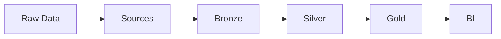

```markdown
# dbt on Databricks — Bronze/Silver/Gold Pipeline

A dbt Core project running on Databricks, implementing a medallion architecture with tests, snapshots, and multi-environment support.

## Stack
- dbt Core 1.12 + dbt-databricks
- Databricks SQL Warehouse + Unity Catalog
- UV for dependency management
- Git for version control

## Architecture



## Project Structure
```
models/
├── bronze/    # passthrough from sources
├── silver/    # cleaned, joined
└── gold/      # facts, dims, aggregates
snapshots/     # SCD Type 2
tests/         # singular tests
macros/        # reusable Jinja
```

## Setup

```bash
uv sync
.venv/Scripts/activate
dbt debug
```

Configure `~/.dbt/profiles.yml` with Databricks host, http_path, catalog, and token (scope: `sql`).

## Commands

| Command | Purpose |
|---|---|
| `dbt parse` | Validate config |
| `dbt run` | Build models |
| `dbt test` | Run tests |
| `dbt build` | run + test + snapshot + seed |
| `dbt build --target prod` | Deploy to prod |

## Environment Parametrization

`profiles.yml` uses `env_var()` so the same project runs against dev or prod:

```yaml
dev:
  catalog: "{{ env_var('DBT_CATALOG_DEV', 'dbt_practice_dev') }}"
prod:
  catalog: "{{ env_var('DBT_CATALOG_PROD', 'dbt_practice_prod') }}"
```
